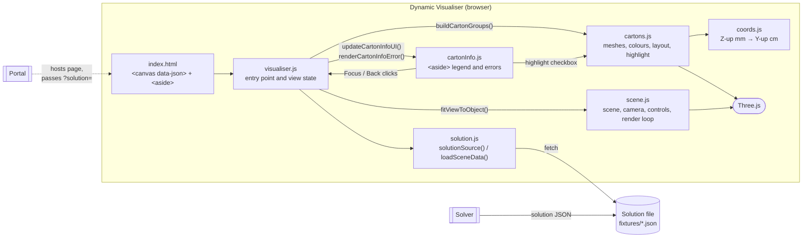

# COMP4050-2026 Dynamic Visualiser

[](https://github.com/sweetpea004/COMP4050-2026-Dynamic-Visualiser/actions/workflows/tests.yml)

## Introduction

The Dynamic Visualiser is the 3D viewer for our COMP4050 packing system. The Solver works out how an order's items should be packed into cartons and writes the result as a JSON solution file. The Visualiser reads that file and shows it as an interactive 3D scene, with every carton drawn to scale and every item placed where the Solver put it.

A packer can rotate, pan and zoom around the cartons, focus on one carton at a time, and highlight individual items. A side panel lists each carton's contents (item, label, weight, tags) and any items the Solver could not pack, with the reason. If the solution file is missing or broken, the Visualiser shows a clear error instead of an empty scene.

## Team Contributors and Roles

| Name | GitHub | Role |
| ---- | ------ | ---- |
| Emma Purvis | [@sweetpea004](https://github.com/sweetpea004) | _TBC_ |
| Mohamad Halloum | [@Halloum578](https://github.com/Halloum578) | _TBC_ (automated testing & CI) |
| _TBC_ | [@hotontheblock](https://github.com/hotontheblock) | _TBC_ |
| _TBC_ | _TBC_ | _TBC_ |

## How to Use

### Prerequisites

- [Node.js](https://nodejs.org/) 20 or newer (CI uses Node 22)
- npm (comes with Node)

### Install and run

```bash
npm install
```

```bash
npm run dev
```

Then open the URL Vite prints (usually <http://localhost:5173>). `npx vite` also works.

### Choosing a solution file

The Visualiser loads the JSON file named in the canvas's `data-json` attribute in [index.html](index.html):

```html
<canvas id="visualiser-canvas" data-json="/fixtures/09_large_order.json"></canvas>
```

To load a different file without editing the HTML, add `?solution=` to the URL:

```
http://localhost:5173/?solution=/fixtures/03_multi_carton.json
```

For safety, `?solution=` only accepts files from the same site or from `localhost` / `127.0.0.1` / `[::1]`. Anything else is ignored and the default file is loaded.

The [fixtures/](fixtures/) folder has sample solutions for common cases: a single item, multiple cartons, rejected items, all items rejected, a large order and a 250-item bulk order.

### Controls

| Action | Mouse / trackpad | Touch |
| ------ | ---------------- | ----- |
| Rotate | Left-click and drag | One-finger drag |
| Pan | Right-click and drag | Two-finger drag |
| Zoom | Scroll wheel / pinch | Two-finger pinch |

In the side panel:

- **Contents** expands a carton to list its items. **Collapse** hides them again.
- **Focus** (shown when there are two or more cartons) shows only that carton. **Back** returns to all cartons.
- Ticking the **checkbox** next to an item outlines that item in the 3D scene.

### Solution JSON format

Lengths are in millimetres and masses in grams. The Solver uses a Z-up coordinate system with each item's `position` at its minimum corner. The Visualiser converts this to Three.js's Y-up system and to centimetres. The fields the Visualiser reads are:

```jsonc
{
  "cartons": [
    {
      "carton_id": "c1",
      "sku": "BOX-S",
      "inner_dims": [220, 160, 120],     // x, y, z in mm
      "contents_mass": 640,              // g
      "placements": [
        {
          "item_ref": "SKU-1183",        // items with the same ref share a colour
          "label": "Wireless Headphones",
          "position": [0, 0, 0],         // min corner, mm
          "dims": [180, 120, 90],        // mm
          "mass": 640,                   // g
          "tags": ["fragile"]
        }
      ]
    }
  ],
  "rejects": [
    { "item_ref": "HUGE-1", "reason_code": "NO_FITTING_CARTON", "message": "Exceeds every carton..." }
  ]
}
```

## Requirements

### MVP Definition

The MVP is the product with the minimum amount of features added in order to meet the main functionality requirements of the product. The Dynamic Visualiser MVP must meet the following requirements.

| Requirement ID | Title | Description |
| ----- | ----- | ---------- |
| Req01 | Read in Solver solution JSON File | Visualiser SHALL read all packing info from a JSON file which is passed as a prop into the `<canvas>` tag in HTML. |
| Req02 | Output 3D Scene with Boxes | The program SHALL visualise a 3D scene with each box (and all its items) supplied in the JSON file with accurate scale and coordinates. |
| Req03 | Scene Movement Controls | The user SHALL be able to rotate, dolly/pan and move the camera using mouse/trackpad and touch controls. |
| Req04 | UI Legend for each Box and Items | An `<aside>` SHALL display a scrollable legend that displays each box and its items with all relevant information. It SHALL also be resized for optimal mobile usage. |
| Req05 | Displaying Item Rejections | The `<aside>` SHALL display the list of rejected items, if any, after the list of boxes. |
| Req06 | Error/empty-state handling for malformed or missing JSON | The visualiser SHALL detect an invalid, incomplete, or missing solution JSON file and SHALL display a clear error message in the `<aside>` in place of an empty or broken 3D scene. |
| Req07 | Item Colouring | Items SHALL be coloured using golden-ratio value stepping to ensure high contrast, with items of the same type having the same colour. |

### Additional Functionality Requirements

These are requirements that surpass the MVP.

| Requirement ID | Title | Description |
| ----- | ----- | ---------- |
| Req08 | Portal Return Buttons | The UI SHALL display "DONE" and "CANCEL" buttons to return the values String OrderID and Bool Complete to the Portal. |
| Req09 | Single Box View | The aside UI SHALL allow the user to view any single box on its own, with a back button to return to the view of all boxes. |
| Req10 | Presenting Each Box with LEGO-like Instructions | The user SHALL be able to step through a step-by-step packing order of a single box with a progression bar, side arrows to step through, and an exit button. (Requires Req09 to be completed). |

## Stack and Structure

### Stack

| Area | Technology |
| ---- | ---------- |
| Language | JavaScript (ES modules), HTML, CSS. No framework. |
| 3D rendering | [Three.js](https://threejs.org/) (`WebGLRenderer`, `OrbitControls`, `CSS2DRenderer` for carton labels) |
| Dev server / bundler | [Vite](https://vite.dev/) |
| Unit & DOM tests | [Vitest](https://vitest.dev/) with [jsdom](https://github.com/jsdom/jsdom) |
| Browser (end-to-end) tests | [Playwright](https://playwright.dev/) (Chromium, desktop and mobile viewports) |
| CI | GitHub Actions |

### Project structure

```
.
├── index.html               # Page shell: <aside> legend + <canvas data-json="...">
├── visualiser.js            # Entry point: loads the solution, builds the scene, wires up the legend
├── visualiser_styles.css    # Layout for desktop and mobile
├── js/
│   ├── solution.js          # Picks the solution file (data-json or ?solution=) and fetches it
│   ├── coords.js            # Solver (Z-up, mm) → Three.js (Y-up, cm) conversions
│   ├── cartons.js           # Builds carton and item meshes, colours, highlighting, carton layout
│   ├── scene.js             # Three.js scene, camera, lights, controls, platform, render loop
│   └── cartonInfo.js        # The <aside> legend: cartons, items, rejects, Focus/Back, errors
├── fixtures/                # Sample Solver outputs used for development and tests
├── tests/
│   ├── unit/                # Vitest tests (run in Node with a simulated DOM)
│   └── e2e/                 # Playwright tests (run the real app in a browser)
├── vitest.config.js
├── playwright.config.js
└── .github/workflows/tests.yml
```

## Architecture



How a solution gets on screen:

1. `visualiser.js` asks `solution.js` which file to load: the `?solution=` URL if it's allowed, otherwise the canvas's `data-json`.
2. `loadSceneData()` fetches and parses the JSON. If that fails, `cartonInfo.js` shows "File Not Found" (HTTP 404) or "Failure to Load" (anything else).
3. `cartons.js` builds a Three.js group per carton, laid out in a row along X, with one coloured mesh per item. `coords.js` converts the Solver's coordinates.
4. `scene.js` sizes the floor platform and points the camera at the visible cartons.
5. `cartonInfo.js` renders the legend. Clicking **Focus** or **Back** calls back into `visualiser.js`, which hides or shows carton groups and reframes the camera.

## Testing

The project has two kinds of automated tests. Both run on every push to `main` and on every pull request through [GitHub Actions](.github/workflows/tests.yml).

| Command | What it runs |
| ------- | ------------ |
| `npm test` | Unit and DOM tests (Vitest). Fast, no browser needed. |
| `npm run test:watch` | Unit tests in watch mode while you code |
| `npm run test:e2e` | Browser tests (Playwright). Starts Vite automatically. |
| `npm run test:all` | Both of the above |

Before your first browser test run, install Playwright's Chromium once:

```bash
npx playwright install chromium
```

Useful Playwright options:

```bash
npx playwright test --ui
```

```bash
npx playwright test --project=desktop-chromium -g "Focus"
```

### What is tested

**Unit tests** ([tests/unit/](tests/unit/)) test each module directly:

| File | Covers |
| ---- | ------ |
| `coords.test.js` | mm → cm conversion and the Z-up → Y-up axis swap |
| `cartons.test.js` | Carton layout and gaps, golden-ratio colouring, same `item_ref` → same colour, mesh counts, labels, highlighting, show/hide. Also builds every fixture and checks each item sits inside its carton. |
| `solution.test.js` | Fetching and error statuses, `?solution=` allow-list (same origin and loopback allowed; other hosts, `javascript:` and `data:` blocked) |
| `cartonInfo.test.js` | Legend contents, weights in kg, tags, reject list, empty state, Focus/Back, Contents toggle, highlight checkboxes, error messages |
| `fixtures.test.js` | Every fixture has the fields the Visualiser reads, items fit in their carton without overlapping, and `contents_mass` matches the item masses |

**Browser tests** ([tests/e2e/](tests/e2e/)) open the real app in Chromium at desktop and mobile (Pixel 7) sizes. They load every fixture and check the scene and the legend, drag and scroll to move the camera, use Focus/Back and Contents, check scrolling and the mobile layout, and check the error messages for a missing file, broken JSON, a server error and a blocked `?solution=` host. Any uncaught error in the page fails the test.

### Requirement coverage

| Requirement | Unit tests | Browser tests |
| ----------- | ---------- | ------------- |
| Req01 Read solution JSON | `solution.test.js` | loading a solution |
| Req02 3D scene to scale | `coords.test.js`, `cartons.test.js` | loading a solution |
| Req03 Camera controls | — | camera controls (desktop) |
| Req04 Legend + mobile | `cartonInfo.test.js` | legend, layout |
| Req05 Rejected items | `cartonInfo.test.js` | legend |
| Req06 Error handling | `solution.test.js`, `cartonInfo.test.js` | error handling |
| Req07 Item colouring | `cartons.test.js`, `cartonInfo.test.js` | — |
| Req09 Single box view | `cartonInfo.test.js` | focus on one carton |

Req08 and Req10 are not built yet, so they have no tests.

### Adding tests

- Put unit tests in `tests/unit/` with a name ending in `.test.js`. `tests/unit/fixtures.js` has helpers to load fixtures.
- Put browser tests in `tests/e2e/` with a name ending in `.spec.js`.
- If you add a new fixture to `fixtures/`, the fixture checks and the "renders every fixture" browser test pick it up automatically.
- `cartonInfo.js` finds `#carton-info` when it is first imported. In unit tests, create the element first and then import the module (see `cartonInfo.test.js`).
- If a failing browser test passes when you run it again, it's probably a timing problem. Wait on a Playwright `expect(...)` instead of adding sleeps.
